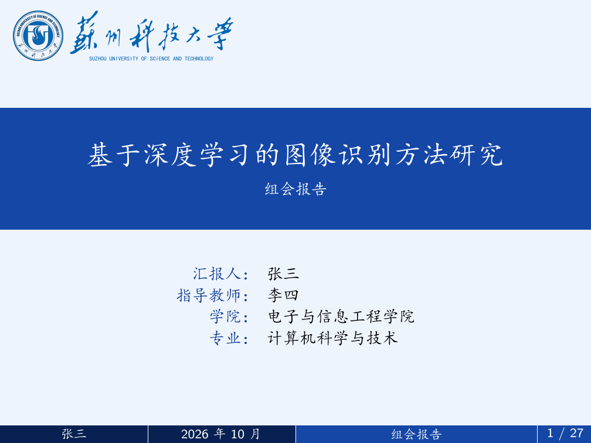

# SUST-Beamer：苏州科技大学组会报告模板

一套适配 **苏州科技大学**（SUST）视觉风格的 Beamer 演示模板，适用于组会报告、课程汇报、答辩等场景。由开源社区流传的高校毕业答辩 Beamer 模板改编：替换了校徽、校名、校训等视觉素材，并将文案与配色统一为苏州科技大学风格。

## 预览



完整效果见仓库内的编译产物 `main.pdf`，其中：

- 正文页：深蓝渐变页眉（章节导航 + 校徽）、三段式页脚
- 章节过渡页带校训"致远至恒 务学悟真"水印

## 使用方法

1. **编译**：本模板使用 XeLaTeX，依赖仓库内 `fonts/` 下的楷体、黑体、宋体字体文件。在仓库根目录执行：

   ```bash
   xelatex main
   bibtex main
   xelatex main
   xelatex main
   ```

   或使用 `latexmk -xelatex main`。

2. **填写报告信息**：打开 `main.tex`，修改文件开头的"报告信息区"即可，封面、页眉、页脚、目录会自动同步：

   ```latex
   \newcommand{\ReportTitle}{基于深度学习的图像识别方法研究}
   \newcommand{\ReportSubtitle}{组会报告}
   \newcommand{\AuthorName}{张三}
   \newcommand{\SupervisorName}{李四}
   \newcommand{\CollegeName}{电子与信息工程学院}
   \newcommand{\MajorName}{计算机科学与技术}
   \newcommand{\ReportDate}{2026 年 10 月}
   ```

3. **章节结构**：目录、页眉导航、章节过渡页由 `\SUSTSectionTitleOne` ～ `\SUSTSectionTitleSix` 与正文中的 `\section` 命令统一控制，增删章节时需同步维护这两处。

4. **图片**：自己的插图放入 `images/` 目录引用。

5. **参考文献**：`references.bib` 为 GB/T 7714 格式示例，替换为自己的文献即可。

## 目录结构

```
SUST-Beamer/
├── main.tex          # 模板主文件（含全部样式定义与示例内容）
├── main.pdf          # 编译预览
├── references.bib    # 参考文献示例（GB/T 7714）
├── assets/           # 校徽、校名、校训素材（模板实际引用）
├── fonts/            # 楷体 / 黑体 / 宋体字体文件
├── images/           # 存放自己的插图
├── docs/             # README 用的预览图
└── tools/            # 素材加工脚本与源图（可重跑生成 assets/）
```

## 说明

- **字体授权**：`fonts/` 内的 SimHei、SimKai、SimSun 等字体文件版权归原厂商所有，仅供个人学习交流使用，请勿用于商业用途；也可改用系统字体（见 `main.tex` 字体区注释）。
- **校训水印**为系统艺术字体渲染，非官方书法图；拿到官方素材后可在 `tools/` 中同名替换重跑脚本。
- 欢迎通过 Issue / PR 反馈问题。
